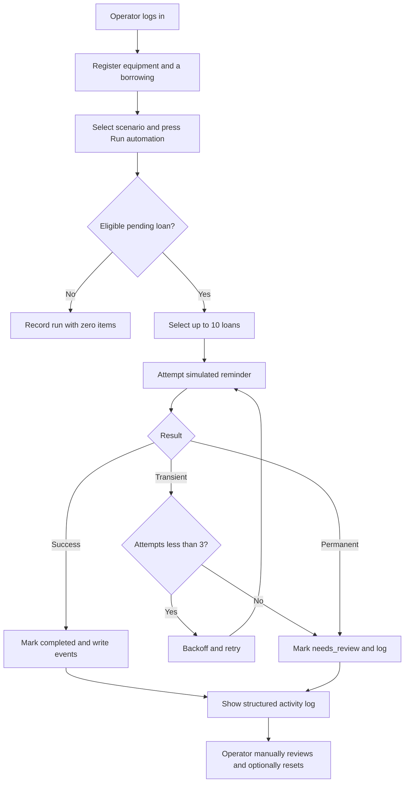
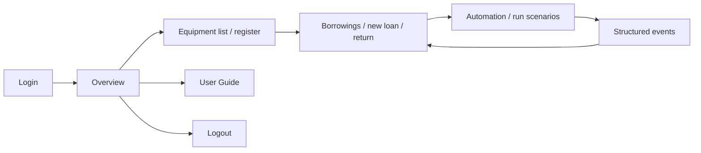

# Week 13 Workflow Boundary, Trigger and API Contract

**System:** Equipment Borrowing Reminder System  
**Student:** Sales, Samuel Jr. C. | BSIT 3 - B  
**Course:** Integrative Programming and Technologies 2 (PFEBSIT 002 / IT Free Elective 2)  
**Date covered:** October 26–30, 2026  
**Delivery scope:** Local proof of concept / simulated notices only.

## 1. Business objective and boundary

A staff operator records equipment, issues a borrowing, and sets a due date. Once a loan falls within the next 48 hours (or is overdue by no more than seven days), the operator may manually invoke reminder automation. The backend selects at most **10 pending eligible loans per run**. For each loan it attempts a simulated delivery with at most **3 attempts** and a 250 ms / 500 ms controlled retry delay for transient errors. Successful simulated deliveries are marked `completed`; permanent failures or exhausted transient attempts are marked `needs_review`. A reviewer may reset a loan to `pending` after inspection and rerun it. An already completed loan is excluded from future runs. Only one automation run may hold the cache lock at a time.

**Explicit non-goals:** no scheduled timer/cron, no external mail/SMS delivery, no user self-registration, no production deployment, no unattended retry queue, and no actual private student data. Backend tokens must never be committed; no plaintext passwords in repository files.

## 2. Trigger decision

**Chosen trigger:** authenticated operator presses **Run automation** in Flutter Web; client calls `POST /api/automation/run` with a local-only simulation scenario. This allows controlled, repeatable classroom testing and avoids accidental notification to real people.

**Rejected alternatives:** browser timer (unreliable if the browser closes), automatic cron or queue worker (adds deployment dependencies), real SMTP or SMS (privacy / credential risks for week 13).

## 3. Workflow diagram

## 4. Flutter Web screen flow

## 5. UI states to demonstrate

| UI state | Trigger / display |
|---|---|
| Loading | A GET/POST request is in progress; progress spinner and disabled Run button |
| Empty | No equipment, borrowing records or events |
| Validation error | Empty name / invalid quantity / expired due date → inline or API message |
| Success | Added equipment, issued loan, completed simulation |
| Unauthorized | Request without an access token → HTTP 401, user must sign in |
| Network failure | API is not reachable → error panel and refresh guidance |
| Server failure | API returns 5xx → generic request failure or returned error text |
| Retry and recovery | Transient event, retry event, second attempt, completion |
| Permanent safe failure | Permanent error event and routed_for_review; no infinite retries |

## 6. API contract

Base URL: `http://127.0.0.1:8000/api` (only the local development environment). Protected calls use `Authorization: Bearer <session-token>`; do not paste token values in screenshots or logs.

| Method | Path | Input | Expected outcome |
|---|---|---|---|
| GET | `/health` | none | 200 + simulation-only marker |
| POST | `/auth/login` | `{email,password}` | 200 + expiring token, or 401 |
| POST | `/auth/logout` | auth bearer | 200 + revoked current token |
| GET | `/dashboard` | auth bearer | 200 + numeric counters |
| GET | `/equipment` | auth bearer | 200 + equipment list |
| POST | `/equipment` | `asset_tag,name,category,quantity_total` | 201 or 422 validation error |
| GET | `/borrowings` | auth bearer | 200 + latest 100 loans |
| POST | `/borrowings` | `equipment_id,borrower_name,due_at` | 201, 422 or not available |
| POST | `/borrowings/{id}/return` | auth bearer | 200, or 409 if already returned |
| POST | `/borrowings/{id}/reset-reminder` | auth bearer | 200 only when needs_review and active |
| GET | `/automation/events` | auth bearer | 200 + last 100 structured events |
| POST | `/automation/run` | `{mode: success\|transient_once\|transient_always\|permanent_failure}` | 200 summary, 409 if busy; mode override local-only |

## 7. Structured event fields

`run_id` (UUID), `borrowing_id` (integer or null), `event_type`, `attempt` (1–3), `result_code`, `created_at` timestamp. Relevant `event_type` values are `delivery_attempt`, `retry_scheduled`, `reminder_completed`, `routed_for_review`, and `run_complete`. Event logs contain identifiers and codes, **not borrower names or credentials**.

## 8. Limitations and risk decisions

- There is no claim of real email/SMS delivery; statuses explicitly describe **simulated** completion.
- The browser holds the bearer token in memory; closing or refreshing the page requires a new login. Use a local example account with a user-chosen strong password.
- The system is a Week 13 prototype, not production ready. Week 14 can add secure exchange review and Week 15 can add systematic hardening.
- SQLite and a local file lock are suited to a single local process demonstration. For multiple workers or production, use tested shared lock storage and a durable queue.
- The docs include only **illustrative reference screenshots**. Real screenshots and logs must be gathered from the running project before submission.
