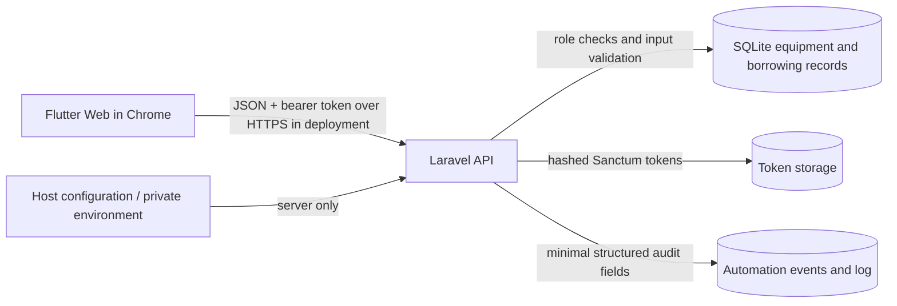

# SA8/IA5 — Secure architecture and controls

## Context and trust boundaries

**Local-only exception:** Flutter at `http://localhost:3000` and Laravel at `http://127.0.0.1:8000` are an HTTP demonstration, not encrypted transport. `SecureApiTransport` rejects HTTP in `staging` and `production`; deploying HTTPS still requires a trusted TLS terminator and trusted proxy configuration.

## Authorization / least privilege

| Route / operation | student | staff | custodian |
|---|---:|---:|---:|
| Log in, log out | Yes | Yes | Yes |
| Read equipment inventory | Yes | Yes | Yes |
| Read aggregate dashboard | Yes | Yes | Yes |
| Read all borrower records | No | Yes | Yes |
| Create borrowing / return item | No | Yes | Yes |
| Create equipment | No | No | Yes |
| Reset failed reminder | No | No | Yes |
| Read automation events | No | No | Yes |
| Run reminder automation | No | No | Yes |

Roles are checked on the server via `EnsureRole`; the Flutter sidebar/button visibility is convenience only. Editing the browser UI or forging `role=custodian` in a POST body must not grant permission. There is **no public role-assignment endpoint**. Existing users gain `staff` from migration (least privilege); the explicitly configured local demo account becomes `custodian` when seeded.

## Authentication and cryptography choice

- Laravel uses its supported password-hashing abstraction (`Hash`, configured by framework) and Sanctum personal access tokens. Sanctum stores **hashes** of bearer tokens in the database.
- An authenticated bearer is required for all non-health API operations; tokens expire after a configured bounded interval, and logout deletes the current token.
- Frontend keeps the token only in process memory; a page refresh requires a new login. HTTPS is used for protecting bearer tokens in transit on any hosted deployment. There is no invented extra AES encryption of public JSON data, no hard-coded API secret in Flutter, and no claimed end-to-end message-signing scheme.
- Browser JavaScript environments cannot fully protect a bearer token from script injection; CSP, dependency review, server monitoring, and more complete session strategy remain future hardening work.

## Validation and information exposure

- Server: equipment id must exist; borrowing names restricted by minimum/maximum length and control-character rejection; due date must be in future; asset tags and quantities validated. State changes are server checked and performed using database transactions for stock changes.
- Client: original Flutter form validators retained; back-end remains authoritative.
- Login response includes display name and role rather than account email/password; other endpoints return minimal necessary fields.
- Automation logs contain run UUID, internal borrowing id, event type, attempt, code. They do not log bearer tokens or borrower names.
- Errors are generic on login and avoid exposing stack traces if `APP_DEBUG=false` in hosted environments.
- Responses specify no-store, no-referrer, nosniff. CORS is origin restricted and has no credentialed cookies.

## HTTPS deployment decision

The new middleware is a secure deployment gate, **not a TLS certificate installer**. A deployment must terminate TLS with a verified certificate, trust only the actual reverse proxy for forwarded HTTPS headers, configure `APP_URL=https://...` and `FRONTEND_ORIGIN=https://...`, and build Flutter with `--dart-define=API_BASE_URL=https://.../api`. Without that environment, HTTPS remains **implemented as policy but not proven to function end-to-end**.
